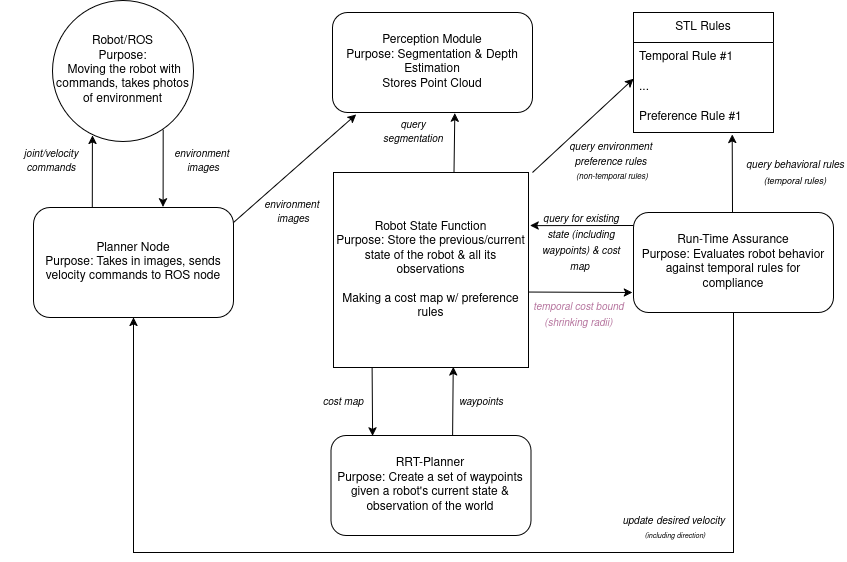

# From Language to Logic: VLM-Grounded Safe Navigation in Novel Environments

This repository contains code and resources for incorporating Signal Temporal Logic into a vision-based autonomous robot navigation system.

## Relevant Papers and Posters:
1. From Language to Logic: VLM-Grounded Safe Navigation in Novel Environments, HCSS 2026, accepted to poster session
2. From Language to Logic: A Theoretical Architecture for VLM-Grounded Safe Navigation, ICUAS 2026, pending 

## Members
- Kristy Sakano, at kvsakano[AT]umd.edu
- Kalonji Harring at kharring[AT]umd.edu
- Matthew Bandos, undergraduate research assistant
- Dr. Mumu Xu, at mumu[AT]umd.edu

## 🚀 V0 Release: Offline Planning Demo

We're excited to announce **V0**, the first release of our offline planning pipeline! This demo validates the integration of route planning and runtime assurance using a deterministic synthetic environment, providing a foundation for future development and testing. Stay tuned for V1, releasing in the next few weeks!

### Objectives of V0
- **Offline Route Planning:** Uses an RRT-X-based planner to generate collision-free routes between a start and goal on a synthetic costmap.
- **Robot State Integration:** Connects the robot's current pose, goal pose, and map observation to the planning pipeline.
- **Route Validation:** Checks that planned waypoints remain within map bounds and that route segments are collision-free.
- **Runtime Assurance (RTA):** Passes the planned route trace to the RTA module for offline evaluation and failure detection.
- **Visualization & Logging:** Generates a top-down route plot and a JSON trace containing route waypoints and trajectory samples.

V0 provides an initial sanity check of the planning pipeline in a controlled, reproducible environment, without requiring live robot operation.

### Setup

From the repository root, create and activate a virtual environment, then install the required dependencies:

**Linux / macOS**
```bash
python3 -m venv .venv
source .venv/bin/activate
pip install -r requirements.txt
```

### Run the Demo

From the repository root, with the virtual environment activated, run:

```bash
python offline_demo.py
```

The demo uses a deterministic synthetic costmap to test the planning pipeline without requiring a live robot. It prints planning and runtime assurance information to the terminal and generates the following artifacts in `src/output/`:

- `offline_demo_top_down.png`: Top-down visualization of the synthetic map and planned route.
- `offline_demo_trace.json`: JSON trace containing route waypoints and trajectory samples.

## Overview


# Installation Instructions
This section details the installation process for this project.

## Docker  

WIP

## From Source

Install [ROS Galactic](https://docs.ros.org/en/galactic/Installation.html). This project makes use of rclpy, sensor_msgs, and and cv-bridge.  

We suggest creating a Python virtual environment before following the steps below.  

Install the project's requirements using pip
`pip install -r requirements.txt`

## Usage

Be sure that ROS has been activated either manually or through your shell's startup script

`source /opt/ros/galactic/setup.bash`  
